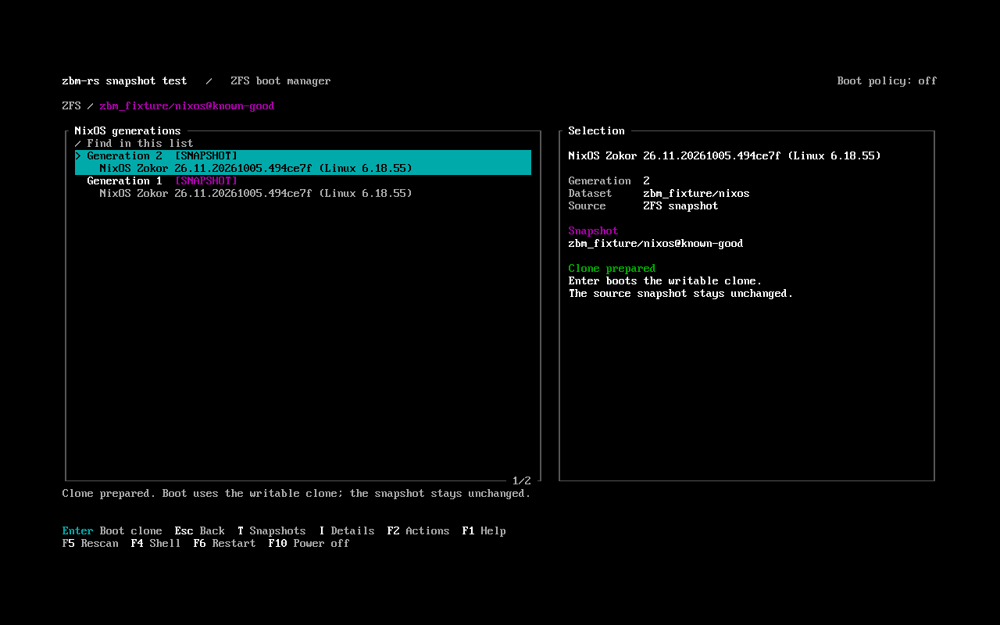
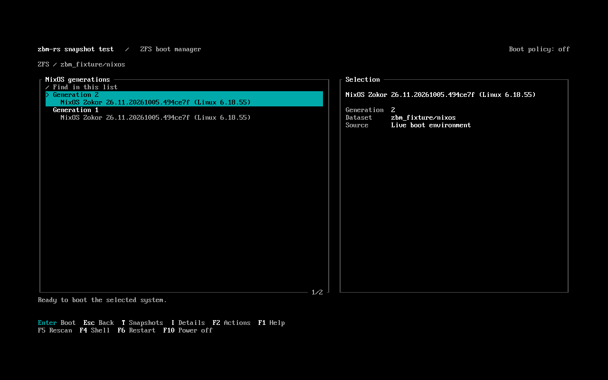
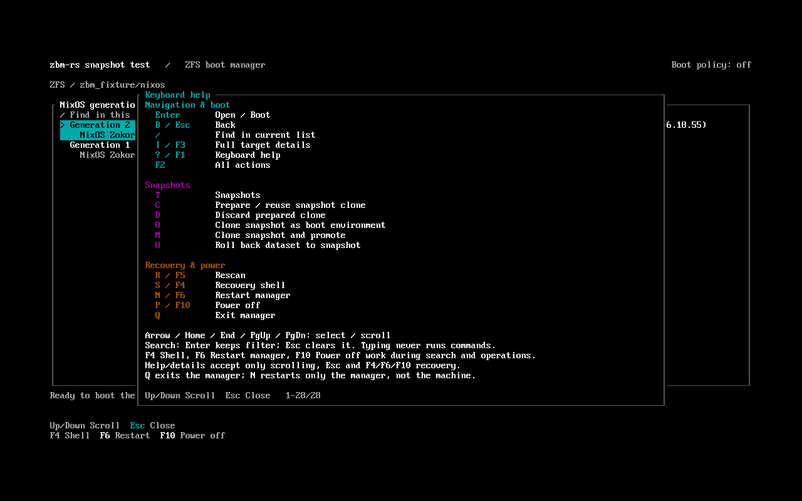

<h1 align="center">zbm-rs</h1>

> A Rust ZFS boot manager with Secure Boot, native NixOS generations, snapshot boot and experimental TPM-authenticated hibernation/resume.

[](https://github.com/okhsunrog/zbm-rs/actions/workflows/check.yml) [](#license) [](docs/roadmap.md)

<p align="center">
  <a href="docs/screenshots/snapshot.png">
    
  </a>
</p>

<p align="center"><sub>NixOS snapshot selection and the prepared clone's boot summary, captured in a disposable QEMU VM.</sub></p>

---

> [!NOTE]
> Secure Boot loading and authenticated hibernation/resume have been tested on a
> physical Framework Laptop 13 (Intel Core Ultra Series 1) running NixOS with
> encrypted ZFS and LUKS2 swap. Firmware rejected the unsigned rescue with Secure
> Boot enabled; rescue booted with it disabled. Enforced NixOS and encrypted Arch
> root/snapshot-clone boot also have OVMF coverage. Default images are unsigned,
> use `security.mode = "off"` and leave hibernation disabled.
> See [tested scope and physical results](docs/verification.md).

## Overview

zbm-rs starts a small Linux environment, discovers boot targets on ZFS and hands
control to the selected OS through kexec. Browse ordinary Linux kernels, NixOS
Bootspec generations and snapshots from one keyboard-driven interface.

- **Secure Boot and verified boot.** Enforced images authorize the exact kernel,
  initramfs, arguments and permitted ZFS root before handoff. Trusted snapshot
  clones follow the same policy.
- **Native NixOS generations.** Select the generation's system closure directly
  from Bootspec, including named specialisations and generations that share a kernel.
  The installation hook publishes the parent and all declared variants even when
  invoked from an installed specialisation: it finds the parent through the
  supplied specialisation link or retained system profiles, then validates the
  exact Bootspec relationship before publishing. An unregistered standalone
  store closure without a discoverable parent is published on its own.
- **Experimental hibernation/resume.** Return to the exact saved NixOS generation
  and specialisation, with plain or LUKS2 dedicated swap. The UI identifies a
  pending session and requires confirmed, verified cancellation before conflicting
  boot or pool operations. An optional patched-kernel backend authenticates RAM
  with TPM under Secure Boot and integrity Lockdown.
- **Writable snapshot boot.** Prepare an owned clone without rolling back the
  source dataset. Ordinary mode also supports confirmed rollback, persistent
  clones and promotion.
- **TPM2 measured boot.** Optionally record the verified prepared target and its
  final arguments in PCR15. The selected OS owns SRK/NvPCR setup.
- **Declarative Nix images.** Build the loader kernel, matching ZFS, userspace,
  configuration and public trust inputs together.
- **Supervised recovery.** A separate PID 1 restores the console after manager
  failure. Enforced mode keeps recovery within the verification policy.

### Screenshots

| NixOS generations | Keyboard help |
| :---: | :---: |
| <a href="docs/screenshots/generations.png"></a> | <a href="docs/screenshots/keyboard-help.png"></a> |

All three screenshots show the real interface in an ordinary-mode disposable VM.
See [their setup and reproduction steps](docs/screenshots/README.md).

## Secure Boot

Firmware verifies the signed loader image. The enforced loader then checks the
selected OS boot inputs as one owner-authorized combination: the kernel signature,
initramfs IMA signature, exact arguments and allowed root selection.

The interface runs without root privileges; a privileged broker resolves and
verifies inputs before loading them. Protected recovery offers diagnostics,
restart, reboot and poweroff. Disabling firmware Secure Boot does not disable an
enforced image's target checks.

Public certificates belong in the image. Owner signing keys stay outside Nix and
image outputs. This verifies boot inputs; it does not authenticate every file in
the selected root or prevent rollback. Read the [trust-chain design](docs/secure-boot-model.md)
and [signing workflow](docs/security-testing.md).

## TPM

An enabled TPM policy measures the verified prepared boot plan in PCR15 after
successful input loading. The event records preparation, not successful OS
execution. SRK/NvPCR setup and OS phase measurements belong to the selected OS.
TPM-based disk unlock, remote attestation, rollback resistance and PCR15 log transport into
the selected OS are not implemented. See [TPM ownership and evidence](docs/tpm.md).

## Hibernation and resume

Opt-in NixOS integration records the running target before hibernation and
restores RAM in the target initramfs before ZFS pool imports or persistent
filesystem mounts. A recognized saved session takes precedence over the normal
default generation or preferred specialisation. Loader inspection uses read-only
pool imports while that session exists.

F2 offers **Discard saved session (stay in menu)** and **Cold boot selected system
(discard saved session)**. Selecting another target or performing a conflicting
pool operation also requires confirmation and verified image invalidation.
Browsing and powering off preserve the session. Independent rescue can cancel a
saved session but never resume it.

Dedicated plain and LUKS2 GPT swap partitions are supported. Enforced resume under
Secure Boot and integrity Lockdown requires the experimental TPM-authenticated
kernel backend and matching signed boot policy. This backend is separate from
PCR15 boot measurements. RAM authentication does not prove that a ZFS pool was
unchanged while hibernated, so the integration remains experimental and disabled
by default.

See the [hibernation design and NixOS configuration](docs/hibernation-design.md),
[kernel patches](nix/patches/hibernation-tpm-7.2.9/README.md) and
[verification results](docs/verification.md).

## Relationship to ZFSBootMenu

[ZFSBootMenu](https://docs.zfsbootmenu.org/en/latest/) established the Linux/initramfs
and kexec model used here. zbm-rs preserves familiar dataset properties and uses
[zfskit](https://github.com/okhsunrog/zfskit) for ZFS operations. Its focus is
integrated boot-input authorization, native NixOS generations and explicit
supervisor, manager and broker roles.

ZFSBootMenu already supports EFI signing, snapshot management and QEMU testing.
Its encryption, recovery and distribution support are broader today. zbm-rs is
an independent implementation with [specific supported layouts](docs/usage.md#supported-layouts)
rather than full feature parity.

## Quick start

Build the unsigned EFI image on an x86_64 Linux host with Nix and flakes enabled:

```sh
nix build .#zbm-rs-efi
```

The output includes `result/esp/EFI/BOOT/BOOTX64.EFI`, the loader kernel, initramfs
and a build manifest. The NixOS module exposes an image without replacing your
existing bootloader. Configuration changes rebuild the image; enforced deployments
use the separate owner signing workflow.

For a disposable QEMU session:

```sh
nix build .#zbm-rs-efi-test --out-link result-test
cargo xtask vm --run target/vm/demo-001 boot --image result-test
```

The test profile includes SSH and harness controls. Use fresh run directories and
disposable guest disks; keep it out of normal deployments. Follow [the build guide](docs/build.md)
for profiles and NixOS integration, or [the development guide](docs/development.md)
for fixtures and VM controls.

## Persistent diagnostics

For intermittent resets or power loss, build with
`loaderConfig.diagnostics = { esp_partuuid = "<GPT partition UUID>"; continuous = true; };`.
The explicitly selected FAT ESP receives `EFI/zbm-rs/diagnostics/boot-*/`:
kernel messages, process exits, UI control/state transitions, full panic backtraces
when available, and periodic memory, temperature, battery and watchdog observations.
No passphrase characters, lengths, backspaces, process memory or RPC payloads are recorded.
Eight boot directories retain up to 4 MiB of trace data each, plus bounded metadata.
The recorder syncs approximately every 250 ms, records a timestamp on each cycle,
and samples health every two seconds. Metadata includes the active CPU microcode
revision and pstore settings. Diagnostic images request task, memory and CPU
backtrace information on kernel panic without enabling new panic triggers.
Storage stalls and hardware caches can increase the unsaved tail; this cannot
guarantee a final message when power disappears. Frequent writes can affect timing.

A separate root process owns a private mount namespace; recording failures do
not stop the UI. Controlled shutdowns and kexec request a bounded flush/unmount.
`last-failure.log` remains the separate failure-time report. Logs are diagnostic
data, not trusted boot inputs. Normal images keep continuous recording disabled.
Inspect/copy the ESP after boot without deleting earlier boot directories.
The VM lifecycle smoke checks persisted logs and password exclusion; add
`--power-cut` to terminate QEMU without a guest shutdown and verify surviving logs.

For early CPU microcode updates, pass an uncompressed microcode cpio through
`mkImage { microcodeInitrd = "${microcodePackage}/intel-ucode.img"; }` or
`programs.zbm-rs.image.microcodeInitrd`. It is embedded in the UKI `.ucode`
section and preserved by the signing publisher. Use the same microcode package
as the installed OS; verify the active revision in the next physical boot log.

## Documentation

- [Secure Boot design](docs/secure-boot-model.md) and [owner signing](docs/security-testing.md)
- [TPM measurements](docs/tpm.md)
- [Hibernation, resume and saved-session cancellation](docs/hibernation-design.md)
- [Boot environments, snapshots and controls](docs/usage.md)
- [Building](docs/build.md) and [configuration](docs/configuration.md)
- [Arch and Framework deployment](docs/arch-deployment.md)
- [Architecture](docs/architecture.md) and [development](docs/development.md)
- [Verification](docs/verification.md) and [roadmap](docs/roadmap.md)

Research and historical test records are linked from [the documentation index](docs/index.md).

## License

Licensed under either [MIT](LICENSE-MIT) or [Apache 2.0](LICENSE-APACHE), at your option.
